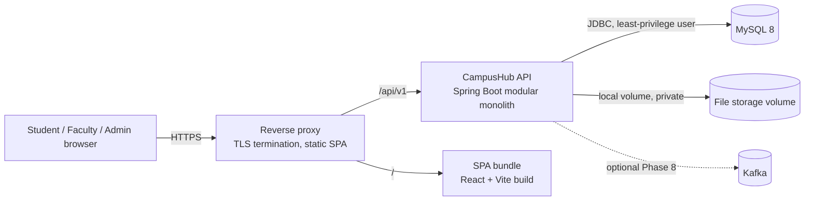

# CampusHub — Architecture

**Purpose:** Describe components, runtime topology, module boundaries, and the rules that keep the system maintainable and secure.
**Scope:** Phase 0–11 target architecture. Choices are justified in [DECISIONS.md](DECISIONS.md).
**Last reviewed:** 2026-11-03 (Phase 0)

## 1. Architectural principles

1. **Modular monolith.** One Spring Boot deployable with internal feature modules (ADR-001). No microservices.
2. **Server-side authorization.** Every private operation is checked in the backend service or policy layer; frontend guards are UX only.
3. **Transactional state changes.** Any change touching several rows commits atomically with its audit row.
4. **Storage behind interfaces.** File storage and events sit behind ports so local and optional implementations can be swapped.
5. **Optional means optional.** Kafka and the outbox are not required for login, tasks, or submissions (ADR-011).
6. **Explicit contracts.** The OpenAPI document is generated from code and checked in CI; `API_CONTRACT.md` is the design source.

## 2. System context



Development uses the Vite dev server with a proxy for `/api`, so the browser sees one origin and CORS is rarely needed locally. Production serves the SPA and API behind the same host through a reverse proxy; CORS remains configured with exact origins for any cross-origin tooling.

## 3. Containers

| Container | Technology | Responsibility | Phase |
|---|---|---|---|
| `frontend` | React 18+, TypeScript, Vite, React Router, Redux Toolkit, RTK Query | SPA, route guards (UX), forms, state | 1+ |
| `backend` | Java 21 LTS, Spring Boot 3.x, Spring Security, Spring Data JPA, Flyway | REST API, authorization, business rules, persistence, audit | 1+ |
| `mysql` | MySQL 8 | Relational store; migrations applied by Flyway | 1+ |
| `file storage` | Docker named volume (dev) or host volume (prod) | Uploaded file bytes, outside the database and outside any web root | 6+ |
| `kafka` (optional) | Apache Kafka (single broker for demo) | Notification event stream | 8 |
| `reverse proxy` | Caddy or Nginx (decided in Phase 10) | TLS, static assets, request size limits | 10 |

## 4. Backend module structure

Single deployable; packages are per feature with shared infrastructure separated.

```text
com.campushub
├── shared          // kernel only: ids, errors (Problem Details), pagination, clock, time zone config
├── infrastructure  // security filter chain, JWT codec, audit writer, file storage port, cache config, Kafka adapters (P2)
├── identity        // users, roles, login, tokens, profiles, admin accounts
├── catalog         // departments, terms, courses
├── projects        // projects, invitations, membership, milestones, status machine
├── tasks           // tasks, transitions, task comments
├── calendar        // read model aggregating milestones and tasks
├── submissions     // submissions, versions, files, deadline rules
├── reviews         // review decisions and feedback
├── skills          // skill catalog and student skills (P1)
├── certifications  // certifications and evidence (P1)
├── dashboards      // read-only aggregate queries
├── audit           // audit log writes and admin reads
└── events          // outbox and publisher (P2)
```

Each feature module contains: `api` (controllers and DTOs), `application` (services with transactions), `domain` (entities and state rules), `persistence` (repositories), and `policy` (authorization checks). Mapping between DTOs and entities lives in each module.

### 4.1 Dependency rules (enforced in Phase 1 by ArchUnit)

- Feature modules depend on `shared` and `infrastructure` only.
- A feature module never imports another module's `persistence` package.
- Cross-module interaction uses another module's `application` service interface or a published read model. Example: `submissions` asks `projects` whether a user is an active member through `ProjectAccessService`, not by querying `project_members` directly.
- Controllers contain no business logic and never return entities.
- `dashboards` and `calendar` are read models: they query other modules' data through read-only services and never write.
- Circular module dependencies fail the build.

## 5. Authorization architecture

Three layers, each necessary:

1. **Coarse role check** — `@PreAuthorize` on controllers for role-only actions (for example, `hasRole('ADMIN')` for catalog writes).
2. **Object policy** — a policy component per feature (for example, `ProjectPolicy.canReview(user, submission)`) that checks membership, supervision, ownership, and state. Services call policies before side effects.
3. **Scoped queries** — list queries always join through membership or supervision; they never filter in memory after loading everything.

Denial mapping follows ADR-006: non-members and unrelated users receive 404 for private resources; authenticated users with a permitted role but an unmet object condition receive 403. The full matrix is in [AUTHORIZATION_MATRIX.md](AUTHORIZATION_MATRIX.md).

## 6. Persistence architecture

- MySQL 8, InnoDB, `utf8mb4`, UTC session time zone (`serverTimezone=UTC` in JDBC URL and `hibernate.jdbc.time_zone=UTC`).
- Flyway migrations `V1__...` onward under `backend/src/main/resources/db/migration`. Migrations run with the migration user; the runtime user has DML only and no DDL.
- Hibernate `ddl-auto=validate` in every profile except disposable Testcontainers tests (which still run Flyway).
- Optimistic locking (`@Version`) on `projects`, `tasks`, `submissions`, and `milestones`.
- Identifiers: internal `BINARY(16)` UUIDs; exposed as canonical strings. Sequential IDs are never exposed.
- Audit rows are append-only at the privilege level: the runtime user has `INSERT, SELECT` on `audit_events` and no `UPDATE` or `DELETE` (ADR-023).

## 7. File storage architecture

- Port: `FileStorage` with `store(stream, key)`, `open(key)`, `delete(key)`. Local adapter is the only implementation in MVP.
- Keys are random UUIDs; original filenames live only in `submission_files.original_filename` after sanitization.
- Root directory set by configuration, outside the web root and outside the repository. Nothing is served statically.
- Downloads stream through an authorized controller with `Content-Disposition: attachment` and `X-Content-Type-Options: nosniff` (SECURITY §5).
- An S3-compatible adapter is a documented extension, not part of MVP (ADR-008).

## 8. Caching architecture

- Spring Cache with Caffeine, in-process, for `departments`, `academic_terms`, `courses`, `skills` (reads only). TTL 10 minutes plus explicit eviction on every admin write.
- Private data (projects, tasks, submissions, dashboards, certifications) is never cached in the server. The browser caches via RTK Query for the session only.
- Keys include the caller's role only where the response varies by role; catalog responses do not vary by user.

## 9. Frontend architecture

- Feature folders mirror backend modules: `auth`, `dashboard`, `projects`, `tasks`, `calendar`, `submissions`, `reviews`, `skills`, `certifications`, `admin`, `shared` (blueprint §8.1).
- **State ownership:**
  - Redux slice `auth`: current user summary and access token in memory only.
  - Redux slice `projectFilters` and `taskFilters`: UI filter state.
  - Redux slice `drafts`: proposal drafts, persisted to `sessionStorage` keyed by user ID and cleared on logout.
  - RTK Query (`api` slice): all server data, with tag-based invalidation.
  - Local component state: forms (React Hook Form with Zod schemas).
- **Memoized selectors** (`createSelector`) for task board grouping, filtered lists, and progress summaries.
- **Route-level code splitting** with `React.lazy` for admin and dashboard routes.
- Every server-driven screen implements loading, empty, error (with retry), success, and forbidden states (UX_UI §4).

## 10. Runtime topology

| Environment | Topology |
|---|---|
| Local development | Vite dev server (5173) proxies `/api` to Spring Boot (8080); Spring connects to MySQL in Compose (3306); files in a Docker volume. |
| CI | GitHub Actions runners; Testcontainers starts MySQL 8 per integration test class. |
| Demo / production | Reverse proxy with TLS; SPA static files; API process; MySQL; file volume; daily backups; health checks (OPERATIONS §2). Hosting per DEPLOYMENT. |

## 11. Quality attributes

| Attribute | Mechanism | Verification |
|---|---|---|
| Security | Three-layer authorization; token revocation; upload validation | Security suite (TEST_STRATEGY §4) |
| Correctness | Guarded state machines; transactions; optimistic locking | Unit and integration tests |
| Performance | Bounded pages; scoped queries; N+1 prevention; cache for catalog only | Query-count assertions; Phase 9 measurements |
| Maintainability | Module rules; ADRs; migrations; OpenAPI contract | ArchUnit; contract check in CI |
| Operability | Health, structured logs, correlation IDs, backups, rollback | OPERATIONS runbook; restore drill in Phase 10 |
| Accessibility | Semantic HTML; keyboard support; axe checks | E2E accessibility tests |

## 12. Failure modes

| Failure | Behavior |
|---|---|
| MySQL unavailable | API readiness fails (503); no partial writes. |
| File storage write fails | Upload fails with 503; no metadata row committed (single transaction around write-then-commit with compensation delete). |
| Kafka unavailable (P2) | Outbox rows accumulate; core workflows continue; relay retries with backoff. |
| Token signing key rotated | Old tokens rejected after rotation; users sign in again (documented in OPERATIONS). |
| Migration fails | Application does not start; rollback procedure in DEPLOYMENT §6. |

## 13. Architecture decision references

| Topic | ADR |
|---|---|
| Modular monolith | ADR-001 |
| MySQL, Flyway, validation | ADR-002 |
| Access tokens and transport | ADR-003 |
| Refresh tokens (deferred) | ADR-004 |
| Password hashing | ADR-005 |
| Authorization model and denial mapping | ADR-006 |
| Admin access to private data | ADR-007 |
| File storage | ADR-008 |
| Frontend state | ADR-009 |
| Caching | ADR-010 |
| Outbox and Kafka | ADR-011 |
| API conventions | ADR-012 |
| Time and time zones | ADR-013 |
| Hosting and deployment | ADR-014 |
| Verification catalog | ADR-015 |
