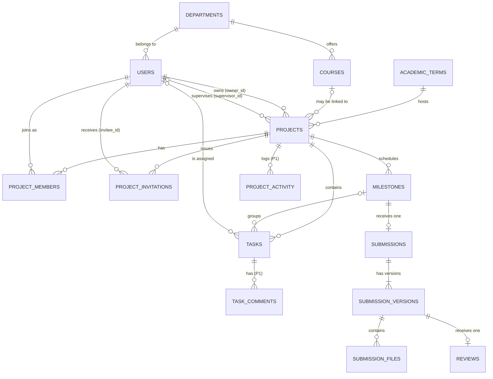
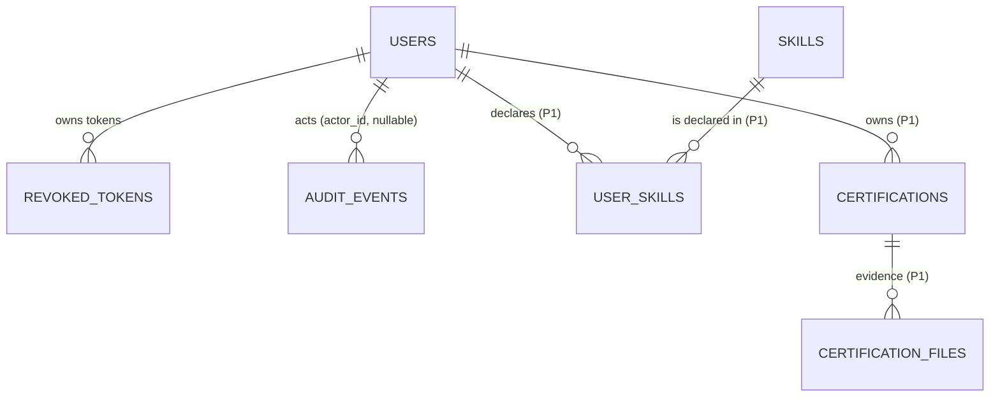
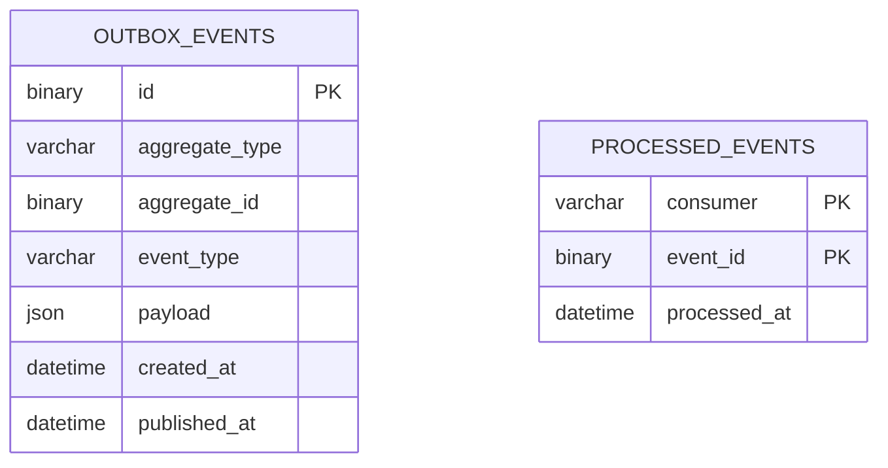

# CampusHub — Entity Relationship Diagram

**Purpose:** Visual map of entities and relationships. Column detail is in [DATA_MODEL.md](DATA_MODEL.md); this file must match it.
**Last reviewed:** 2026-11-03 (Phase 0)

## 1. Core project, team, and submission graph

## 2. Identity, skills, and audit

## 3. Phase 8 (optional)

Outbox rows are written in the same transaction as the domain change; `processed_events` is keyed per consumer so one event can be consumed by more than one consumer.

## 4. Cardinality rules that matter

| Relationship | Rule | Enforced by |
|---|---|---|
| Project ↔ owner | Exactly one OWNER membership per project | Generated `owner_key` unique index |
| Project ↔ supervisor | Zero or one supervisor; required from APPROVED | CHECK constraint on status and `supervisor_id` |
| Milestone ↔ submission | At most one submission per milestone | `UNIQUE (milestone_id)` on `submissions` |
| Submission version ↔ review | At most one review per version | `UNIQUE (version_id)` on `reviews` |
| Task ↔ milestone | Same project only | Composite FK `(project_id, milestone_id)` |
| Invitation | At most one PENDING per project and invitee | Generated `pending_key` unique index |
| Team size | ≤ 5 members including owner (OD-3) | Service check inside a locked project row |
