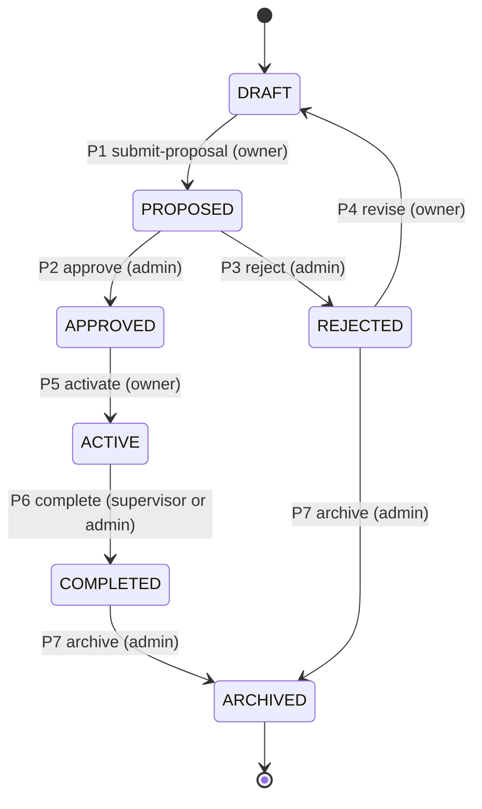
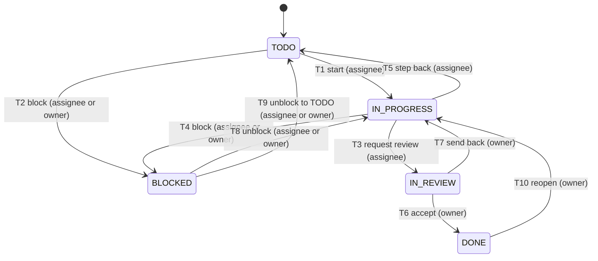
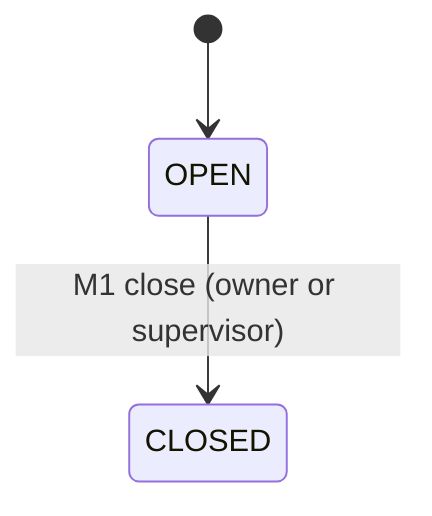
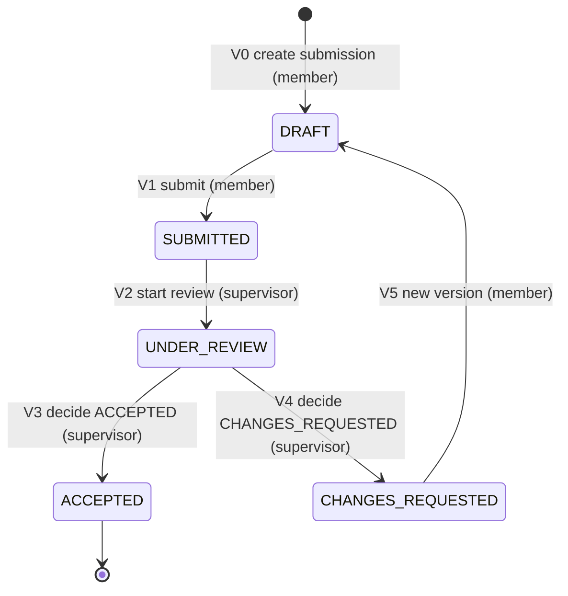
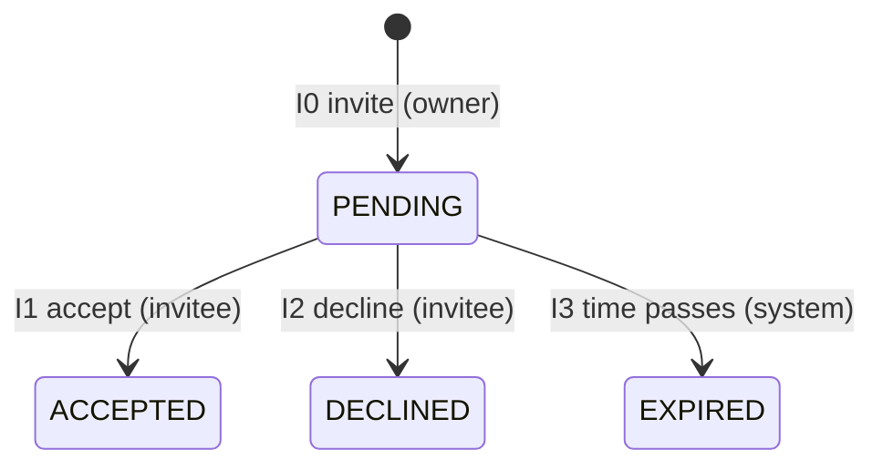
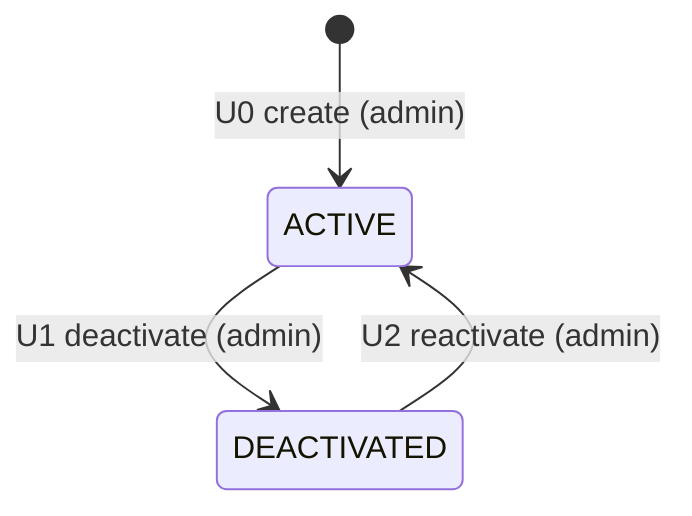

# CampusHub — State Machines

**Purpose:** Single source of truth for every stateful entity: its states, the transitions allowed between them, who may trigger each transition, the guard that must hold, the side effects, and the error returned when the move is refused.
**Scope:** Phase 1–7 entities plus the optional P2 outbox behavior (not a state machine of its own).
**Last reviewed:** 2026-11-03 (Phase 0)
**Related:** [API_CONTRACT.md](API_CONTRACT.md) (endpoints and error codes), [AUTHORIZATION_MATRIX.md](AUTHORIZATION_MATRIX.md) (who may call), [DATA_MODEL.md](DATA_MODEL.md) (persisted columns), [DECISIONS.md](DECISIONS.md).

## 1. Rules that apply to every machine

1. **Evaluation order.** A request is evaluated in this order and stops at the first failure:
   1. Authentication (401 `UNAUTHENTICATED`).
   2. Password-change gate (403 `PASSWORD_CHANGE_REQUIRED`).
   3. Role check for the endpoint → 403 `FORBIDDEN_ROLE`. This runs before any lookup, so a role-only endpoint returns the same 403 for an existing and a nonexistent ID and does not reveal which projects exist.
   4. Concealment: caller cannot see the resource → 404 `NOT_FOUND`.
   5. Object condition (ownership, assignment, supervision of the object) → 403 `FORBIDDEN_STATE`.
   6. Optimistic lock (`version`) → 409 `STALE_VERSION`.
   7. Transition legality → 409 `INVALID_TRANSITION`.
   8. Business preconditions for the target state → 422 with the specific code (for example `PROPOSAL_INCOMPLETE`, `PRECONDITION_NOT_MET`).
2. **Authorization decides 403 versus 404; the state machine decides 409 and 422.** A permitted actor who asks for an illegal move gets 409 or 422, never 403, except where the object condition is about who the actor is (assignee, owner, supervisor). This keeps the codes meaningful for the UI.
3. **Same-state requests are refused.** Asking for the state the object already has returns 409 `INVALID_TRANSITION` with the current state in `detail`. Transitions are therefore idempotent by check, not by key (API_CONTRACT §1).
4. **Every transition is audited** in the same transaction (ADR-023). The audit action name is given in each table.
5. **Terminal states** have no outgoing transitions. Writes against a terminal or read-only state return the specific 422 from §2.3 (for example `PROJECT_ARCHIVED`) rather than `INVALID_TRANSITION`, so the reason is clear to the user.
6. **Time-based transitions** (invitation expiry) are applied lazily on read and by an hourly job. The job is idempotent.

## 2. Project

### 2.1 States

| State | Meaning | Terminal |
|---|---|---|
| `DRAFT` | Owner is preparing a proposal. Editable. | No |
| `PROPOSED` | Submitted for administrator review. Read-only for the owner. | No |
| `REJECTED` | Administrator rejected the proposal with a reason. | No (may revise or archive) |
| `APPROVED` | Accepted and supervisor assigned. Team may form and plan. | No |
| `ACTIVE` | Work in progress: tasks, milestones, submissions. | No |
| `COMPLETED` | All milestones closed; work accepted by the supervisor. Read-only except archive. | No |
| `ARCHIVED` | Retired from active use. Read-only. | Yes |

### 2.2 Transitions

| ID | From → To | Endpoint | Actor | Guard | Side effects | Audit action | Refusal |
|---|---|---|---|---|---|---|---|
| P1 | DRAFT → PROPOSED | `POST /projects/{id}/submit-proposal` | owner | `title`, `description`, `termId` (term ACTIVE), and ≥ 1 milestone present | Clears `rejectionReason`; stamps `proposedAt` | `project.proposal.submitted` | 422 `PROPOSAL_INCOMPLETE` with `missing[]` |
| P2 | PROPOSED → APPROVED | `POST /projects/{id}/approve` | ADMIN | A supervisor is assigned and is ACTIVE FACULTY | Stamps `approvedAt`, `approvedBy` | `project.approved` | 422 `SUPERVISOR_NOT_ELIGIBLE` |
| P3 | PROPOSED → REJECTED | `POST /projects/{id}/reject` | ADMIN | `reason` 1–1000 characters | Stores `rejectionReason` | `project.rejected` | 422 `VALIDATION_FAILED` for an empty reason |
| P4 | REJECTED → DRAFT | `POST /projects/{id}/revise` | owner | None | Reopens the project for editing. `rejectionReason` stays visible until the next P1 | `project.revised` | 409 `INVALID_TRANSITION` |
| P5 | APPROVED → ACTIVE | `POST /projects/{id}/activate` | owner | ≥ 1 member whose account is ACTIVE (the owner counts) | Enables task creation and submissions | `project.activated` | 422 `PRECONDITION_NOT_MET` with `missing[]` |
| P6 | ACTIVE → COMPLETED | `POST /projects/{id}/complete` | supervisor, ADMIN | ≥ 1 milestone and every milestone CLOSED | Freezes task and submission writes | `project.completed` | 422 `PRECONDITION_NOT_MET` with `missing[]` |
| P7 | COMPLETED or REJECTED → ARCHIVED | `POST /projects/{id}/archive` | ADMIN | None | Read-only for everyone | `project.archived` | 409 `INVALID_TRANSITION` |

Transitions not listed are refused with 409 `INVALID_TRANSITION`. Notable refusals: archiving an APPROVED project, completing a PROPOSED project, and revising an ACTIVE project.

### 2.3 What each state permits

Writes that the machine does not cover are gated by the state as follows. All refusals use the codes shown.

| Action | DRAFT | PROPOSED | REJECTED | APPROVED | ACTIVE | COMPLETED | ARCHIVED |
|---|---|---|---|---|---|---|---|
| Edit title, description, term, course (`PATCH /projects/{id}`) | yes | no (422 `PROJECT_NOT_EDITABLE`) | yes | no (422 `PROJECT_NOT_EDITABLE`) | no (422 `PROJECT_NOT_EDITABLE`) | no (422 `PROJECT_NOT_EDITABLE`) | no (422 `PROJECT_ARCHIVED`) |
| Assign or reassign supervisor | yes | yes | yes | yes | yes | no | no |
| Invite a member, accept an invitation | yes | yes | yes | yes | yes | no (422 `PROJECT_NOT_OPEN_FOR_MEMBERSHIP`) | no (422 `PROJECT_NOT_OPEN_FOR_MEMBERSHIP`) |
| Remove a member | yes | yes | yes | yes | yes | no | no |
| Create or edit milestones | yes | no | yes | yes | yes | no | no |
| Create tasks | no | no | no | yes | yes | no | no |
| Transition tasks | no | no | no | yes | yes | no | no |
| Create a submission or upload files | no | no | no | no | yes | no | no |
| Review a submitted version | no | no | no | no | yes | no | no |

Reviews are allowed only while ACTIVE so that a COMPLETED project has a fixed record. A supervisor who needs to review after a milestone closes can still do so, because closing a milestone does not change the project state.

### 2.4 Team rules

- Team size is limited to 5 members including the owner (OD-3). The check runs inside a locked project row, so two concurrent acceptances cannot exceed the cap (409 `TEAM_FULL`).
- The owner cannot be removed (422 `PRECONDITION_NOT_MET`). Ownership transfer is not in MVP.
- Removing a member unassigns that member's open tasks in the same transaction. Tasks keep their status, so a task that was `IN_PROGRESS` becomes unassigned and `IN_PROGRESS`, and the owner reassigns it.
- A student may be a member of several projects, but may hold at most one membership per project. Accepting a second invitation to the same project returns 409 `DUPLICATE`.

## 3. Task

### 3.1 States

| State | Meaning | Terminal |
|---|---|---|
| `TODO` | Planned, not started. | No |
| `IN_PROGRESS` | Assignee is working on it. | No |
| `IN_REVIEW` | Assignee has finished and the owner must confirm. | No |
| `BLOCKED` | Cannot proceed. Requires a `blockedReason` (FR-TASK-04). | No |
| `DONE` | Confirmed complete by the owner. Counts toward progress. | No (controlled reopen only) |

### 3.2 Transitions

All task transitions go through `POST /tasks/{id}/transitions` with body `{to, version, blockedReason?}`. The `to` value is validated against the table, so a client cannot set any status it likes (blueprint §8.3). `status` is never writable through `PATCH /tasks/{id}` (400 `FIELD_NOT_EDITABLE`).

| ID | From → To | Actor | Guard | Side effects | Audit action |
|---|---|---|---|---|---|
| T1 | TODO → IN_PROGRESS | assignee | Task has an assignee; project APPROVED or ACTIVE | None | `task.started` |
| T2 | TODO → BLOCKED | assignee, owner | `blockedReason` 3–500 characters | Stores `blockedReason` | `task.blocked` |
| T3 | IN_PROGRESS → IN_REVIEW | assignee | Project APPROVED or ACTIVE | None | `task.review_requested` |
| T4 | IN_PROGRESS → BLOCKED | assignee, owner | `blockedReason` 3–500 characters | Stores `blockedReason` | `task.blocked` |
| T5 | IN_PROGRESS → TODO | assignee | None | None | `task.reset` |
| T6 | IN_REVIEW → DONE | owner | None | Stamps `completedAt`; counts toward progress | `task.completed` |
| T7 | IN_REVIEW → IN_PROGRESS | owner | None | None | `task.returned` |
| T8 | BLOCKED → IN_PROGRESS | assignee, owner | None | Clears `blockedReason` | `task.unblocked` |
| T9 | BLOCKED → TODO | assignee, owner | None | Clears `blockedReason` | `task.unblocked` |
| T10 | DONE → IN_PROGRESS | owner | None | Clears `completedAt`. Controlled reopen; the reason is not captured in MVP | `task.reopened` |

Rules that apply to every task transition:

- An **unassigned** task can be moved only by the owner.
- A member who is neither assignee nor owner receives 403 `FORBIDDEN_STATE` (NS-11). A non-member receives 404 `NOT_FOUND`.
- Only the owner can mark a task `DONE`. A student who worked on a task therefore cannot close it themselves. This is the reason `IN_REVIEW` exists: the blueprint's flow `IN_PROGRESS → IN_REVIEW → DONE` is kept intact (blueprint §8.3).
- Transitions are refused with 422 `PROJECT_NOT_EDITABLE` when the project is not APPROVED or ACTIVE. Task transitions are not allowed after the project is COMPLETED or ARCHIVED.
- Changing the status of a task whose milestone is CLOSED is allowed. A closed milestone freezes submissions, not planning.

## 4. Milestone

### 4.1 States

| State | Meaning | Terminal |
|---|---|---|
| `OPEN` | Accepts uploads and submissions until its deadline (`dueAt`) or until closed. | No |
| `CLOSED` | No further uploads or submissions. Reviews still possible. | Yes in MVP (irreversible) |

### 4.2 Transitions and rules

| ID | From → To | Endpoint | Actor | Guard | Audit action | Refusal |
|---|---|---|---|---|---|---|
| M1 | OPEN → CLOSED | `POST /milestones/{id}/close` | owner, supervisor | Project ACTIVE or APPROVED | `milestone.closed` | 409 `INVALID_TRANSITION` if already CLOSED |

- Editing: the owner changes `title` and `dueAt`; the supervisor changes only `allowLate`. Any other field returns 400 `FIELD_NOT_EDITABLE` for that caller. Edits require `version` and are refused on a CLOSED milestone (409 `INVALID_TRANSITION`).
- Creation is allowed only while the project is DRAFT, REJECTED, APPROVED, or ACTIVE. The service assigns `sequence`.
- A milestone's `dueAt` is in UTC (ADR-013). The deadline check on submission uses the server clock, never the client clock.
- Closing a milestone that holds a DRAFT version leaves that version in place. The member cannot submit it (422 `MILESTONE_CLOSED`) and cannot upload to it. The draft is kept for audit and is shown to the supervisor as "not submitted".
- Closing is irreversible in MVP. Re-opening is recorded as a future decision (see DECISIONS, Phase 0 open items).

## 5. Submission version

A submission is the container for one milestone's versions (`UNIQUE (milestone_id)` on `submissions`). It has no state of its own. Its current state is the state of its latest version.

### 5.1 States

| State | Meaning | Sealed | Terminal |
|---|---|---|---|
| `DRAFT` | Editable by the member. Files may be added and removed. | No | No |
| `SUBMITTED` | Sealed. Waiting for the supervisor. | Yes | No |
| `UNDER_REVIEW` | Supervisor has opened the review. | Yes | No |
| `CHANGES_REQUESTED` | Supervisor requested changes with feedback. A new version may be created. | Yes | No |
| `ACCEPTED` | Supervisor accepted this version. | Yes | Yes for this version |

### 5.2 Transitions

| ID | Transition | Endpoint | Actor | Guard | Side effects | Audit action | Refusal |
|---|---|---|---|---|---|---|---|
| V0 | (none) → DRAFT v1 | `POST /milestones/{id}/submission` | member | Milestone OPEN; project ACTIVE | Creates submission and v1 | `submission.created` | 409 `SUBMISSION_EXISTS`; 422 `MILESTONE_CLOSED` |
| V1 | DRAFT → SUBMITTED | `POST /submission-versions/{id}/submit` | member | ≥ 1 file (422 `NO_FILES`); `now ≤ dueAt` or milestone `allowLate` (422 `DEADLINE_PASSED`); milestone OPEN | Sets `sealed_at`; sealed rows are immutable (trigger, ADR-018) | `submission.version.submitted` | 409 `VERSION_SEALED` if already sealed |
| V2 | SUBMITTED → UNDER_REVIEW | `POST /submission-versions/{id}/review/start` | supervisor of the project | None | Records `reviewStartedAt` | `submission.review.started` | 409 `INVALID_TRANSITION` |
| V3 | UNDER_REVIEW → ACCEPTED | `POST /submission-versions/{id}/review` with `decision=ACCEPTED` | supervisor | None | Writes one `reviews` row | `submission.version.accepted` | 409 `REVIEW_EXISTS` |
| V4 | UNDER_REVIEW → CHANGES_REQUESTED | `POST /submission-versions/{id}/review` with `decision=CHANGES_REQUESTED` | supervisor | `feedback` 1–2000 characters (422 `FEEDBACK_REQUIRED`) | Writes one `reviews` row | `submission.version.changes_requested` | 409 `REVIEW_EXISTS` |
| V5 | CHANGES_REQUESTED → DRAFT (new version) | `POST /submissions/{id}/versions` | member | Latest version is CHANGES_REQUESTED | Creates version n+1 with no files | `submission.version.created` | 409 `INVALID_TRANSITION` if the latest version is not CHANGES_REQUESTED |

Rules:

- **Immutability.** Once `sealed_at` is set, the version and its files cannot change. The service checks it first (409 `VERSION_SEALED`); MySQL triggers enforce it at the database level, so a bug in the service cannot rewrite history (ADR-018). Test NS-10 asserts the row is unchanged after the attempted write.
- **New versions start empty.** Files are not copied from the previous version, because each stored object has a unique key and copying bytes adds storage cost for little benefit in MVP. The UI shows the previous version's file list as read-only context.
- **Supervisor change.** Reviews are authorized by the *current* supervisor. If the supervisor is reassigned during review, the new supervisor completes the review and the previous supervisor loses access (404 thereafter).
- **Review and milestone.** Closing a milestone does not block a review (§4.2).
- **Deadline on resubmission.** The deadline applies to every version that is sealed. A late resubmission after `CHANGES_REQUESTED` therefore needs `allowLate` on the milestone, which the supervisor enables.

## 6. Invitation

### 6.1 States

| State | Meaning | Terminal |
|---|---|---|
| `PENDING` | Issued and awaiting the invitee. | No |
| `ACCEPTED` | Invitee joined the project. | Yes |
| `DECLINED` | Invitee declined. | Yes |
| `EXPIRED` | Not answered within 14 days. | Yes |

### 6.2 Transitions

| ID | From → To | Endpoint | Actor | Guard | Side effects | Refusal |
|---|---|---|---|---|---|---|
| I0 | (none) → PENDING | `POST /projects/{id}/invitations` | owner | Project DRAFT, PROPOSED, REJECTED, APPROVED, or ACTIVE; invitee is ACTIVE STUDENT; team below 5; no existing PENDING invitation and not already a member | Stores `expiresAt = createdAt + 14 days` | 409 `TEAM_FULL`, 409 `DUPLICATE`, 422 `PROJECT_NOT_OPEN_FOR_MEMBERSHIP`, 422 `VALIDATION_FAILED` (invitee not a student) |
| I1 | PENDING → ACCEPTED | `POST /invitations/{id}/accept` | invitee | Invitation is PENDING and not expired; team below 5 (checked under the project lock); project open for membership | Creates `project_members` row in the same transaction | 409 `TEAM_FULL`, 422 `PROJECT_NOT_OPEN_FOR_MEMBERSHIP`; 404 for non-invitee |
| I2 | PENDING → DECLINED | `POST /invitations/{id}/decline` | invitee | Invitation is PENDING | None | 404 for non-invitee; 409 `INVALID_TRANSITION` if not PENDING |
| I3 | PENDING → EXPIRED | (lazy on read and hourly job) | system | `expiresAt < now` | None | Not refused; the job and reads apply it |

- An invitation to a project that has since closed to membership cannot be accepted (422 `PROJECT_NOT_OPEN_FOR_MEMBERSHIP`) and stays PENDING until it expires.
- There is no revoke endpoint in MVP. An owner who wants to withdraw an invitation waits for it to expire or asks the administrator. This is recorded in RISKS.

## 7. Account (user)

### 7.1 Status

| State | Meaning | Terminal |
|---|---|---|
| `ACTIVE` | May sign in and use the system. | No |
| `DEACTIVATED` | Cannot sign in. All tokens are invalid (`revoked_after`). Data is retained. | No (reactivation exists) |

Lockout is a separate, time-limited condition (`locked_until`), not a status.

### 7.2 Transitions and rules

| ID | Transition | Endpoint | Actor | Guard | Side effects | Refusal |
|---|---|---|---|---|---|---|
| U0 | (none) → ACTIVE, `mustChangePassword = true` | `POST /admin/users` | ADMIN | Email unique | Returns `temporaryPassword` once | 409 `DUPLICATE` |
| U1 | ACTIVE → DEACTIVATED | `POST /admin/users/{id}/deactivate` | ADMIN | Target is not the last ACTIVE admin | Sets `status`; sets `revoked_after = now` | 422 `PRECONDITION_NOT_MET` (last admin) |
| U2 | DEACTIVATED → ACTIVE | `POST /admin/users/{id}/reactivate` | ADMIN | None | Sets `status`; does not restore tokens | 409 `INVALID_TRANSITION` if already ACTIVE |

Lockout and password rules (SECURITY §3, ADR-005):

- Five consecutive failed sign-ins set `locked_until = now + 15 min`. A successful sign-in resets `failed_login_count`.
- While locked, sign-in attempts return the same 401 `INVALID_CREDENTIALS` as a wrong password, with comparable timing (a dummy BCrypt check runs). The lock is therefore not observable from the response.
- Attempts during a lock do not increment `failed_login_count`, so a locked account cannot be pushed further into a lock by an attacker.
- Password reset (`/admin/users/{id}/reset-password`) and deactivation both set `revoked_after`. Any token issued before that instant is rejected (NS-08).
- `mustChangePassword` becomes false after a successful `POST /auth/change-password`. Until then, every endpoint except `/auth/me`, `/auth/logout`, and `/auth/change-password` returns 403 `PASSWORD_CHANGE_REQUIRED`.

## 8. Submission files

Files have no state machine of their own. A file exists while its version is DRAFT and is removed by `DELETE`, or is sealed with its version. The rules are:

- Five files per version (422 `FILE_LIMIT_EXCEEDED`), 20 MiB each (413 `FILE_TOO_LARGE`), allowlisted magic bytes (422 `FILE_TYPE_NOT_ALLOWED`). See SECURITY §5.
- Upload is refused with 422 `MILESTONE_CLOSED` or `DEADLINE_PASSED`, and with 409 `VERSION_SEALED` once the version is sealed.
- A failed storage write leaves no metadata row. A successful write whose database commit fails is compensated by deleting the stored object (ARCHITECTURE §12).

## 9. Outbox event lifecycle (P2)

Applies only when `CAMPUSHUB_KAFKA_ENABLED=true` (Phase 8). Outbox rows move from `pending` (`published_at IS NULL`) to `published` (`published_at` set) once the relay has sent them. Failed relays retry with backoff; no state is lost. The lifecycle has no user-visible state.

## 10. Verification

- Each transition ID in §2–§8 has at least one test that asserts the success path and one that asserts the refusal code.
- The project state table in §2.3 is generated into a parameterized test that calls each write endpoint in each state (TEST_STRATEGY §3).
- Illegal transitions are tested by attempting every ordered pair of distinct states that is not listed, expecting 409 `INVALID_TRANSITION`, plus each same-state request (rule 3). For task states that is 20 distinct pairs minus the 10 legal transitions, plus 5 same-state requests.
